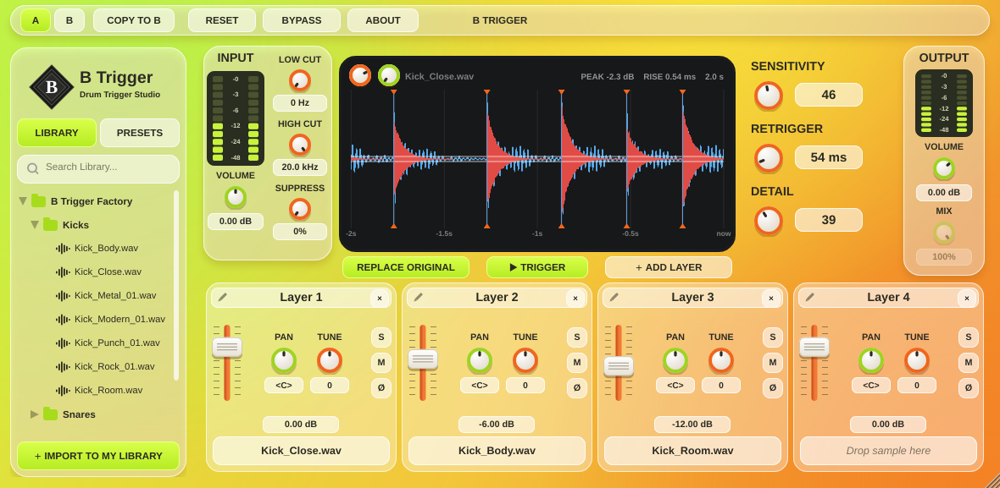
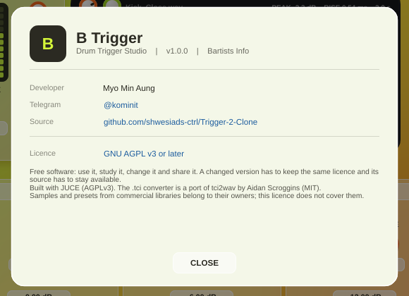
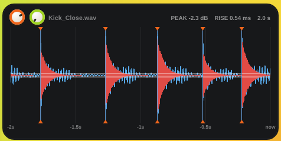
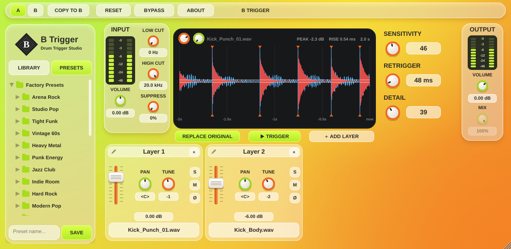
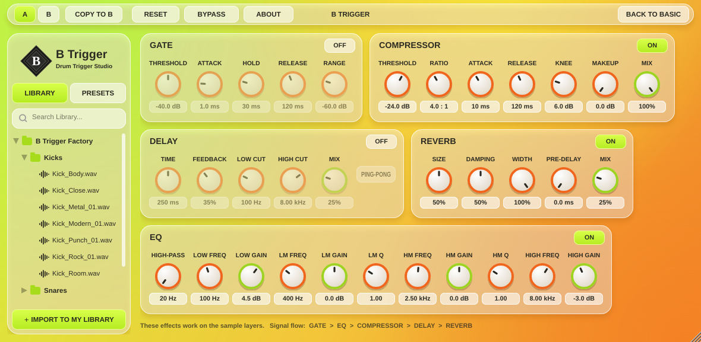

# B Trigger

A drum trigger plugin: it listens to a drum track, finds every hit, and plays your own samples in place of the
original drum (or mixed with it). VST3, Audio Unit and a standalone app, for Windows and macOS.

Free software, built with [JUCE](https://juce.com).



## Download

| | |
|---|---|
| **Windows** | [B-Trigger-Windows.zip](https://github.com/shwesiads-ctrl/Trigger-2-Clone/releases/download/Windows-latest/B-Trigger-Windows.zip) |
| **macOS** | [B-Trigger-macOS.zip](https://github.com/shwesiads-ctrl/Trigger-2-Clone/releases/download/macOS-latest/B-Trigger-macOS.zip) |

These links always point at the newest build. The [releases page](https://github.com/shwesiads-ctrl/Trigger-2-Clone/releases)
says which commit each one was built from.

## Install

| File in the zip | Where it goes | Used by |
|---|---|---|
| `B Trigger.vst3` | Windows: `C:\Program Files\Common Files\VST3\`<br>macOS: `/Library/Audio/Plug-Ins/VST3/` | Studio One, Cubase, FL Studio, Live, Reaper |
| `B Trigger.component` | macOS: `/Library/Audio/Plug-Ins/Components/` | Logic Pro, GarageBand, Final Cut |
| `B Trigger.exe` / `B Trigger.app` | anywhere you like | runs on its own, without a DAW |

**Windows.** Right-click the zip, open Properties, tick **Unblock**, then extract it. Copy the whole
`B Trigger.vst3` **folder**, not just the file inside it. The first run of `B Trigger.exe` may show a SmartScreen
warning: choose *More info*, then *Run anyway*. The plugin is not signed with a paid certificate, so Windows
has nothing to check it against.

**macOS.** Copy the files, then clear the quarantine flag (see below) and rescan in your DAW. Logic only looks
for Audio Units when it starts, so quit Logic first; if it still does not appear, run
`killall -9 AudioComponentRegistrar`, open Logic again and let it scan. **Logic Pro > Settings > Plug-in Manager**
shows the result and can rescan. The plugin appears under the manufacturer **Bartists Info**.

### macOS: "B Trigger.vst3 is damaged and can't be opened"

Nothing is damaged. macOS puts a quarantine flag on anything downloaded from the internet and refuses to open it
unless Apple has notarized it, which needs a paid Apple Developer account. Clear the flag yourself:

```sh
xattr -dr com.apple.quarantine "/Library/Audio/Plug-Ins/VST3/B Trigger.vst3"
xattr -dr com.apple.quarantine "/Library/Audio/Plug-Ins/Components/B Trigger.component"
xattr -dr com.apple.quarantine "/Applications/B Trigger.app"
```

Then open your DAW again and rescan. Do this each time you download a new build.

## Quick start

1. Put B Trigger on a drum track (kick, snare or tom) as an insert effect.
2. Play the track. Red is what the trigger detector hears; the two white lines are the threshold.
3. Turn **SENSITIVITY** until there is an orange marker on every hit you want, and none in between.
4. Pick a sample in the library and double-click it, or drag it onto a layer.
5. **REPLACE ORIGINAL** is on, so only your sample plays. Switch it off and use **MIX** to blend instead.

The plugin reports a latency of about 1.5 ms so the samples stay lined up with the original drums.

## The interface

### Top bar

- **A / B** — two complete sets of settings, for comparing. B starts as a copy of A the first time you open it.
  **COPY TO B** (or **COPY TO A**) copies the current settings across. Both are kept with the project.
- **RESET** — puts every knob, layer and effect back to the starting sound. The first click turns the button
  into *SURE?*; a second click within three seconds does it.
- **BYPASS** — passes the audio straight through and plays no samples. The detector keeps running and the
  waveform still marks the hits, so you can set the trigger up while bypassed. The host's own bypass switch is
  wired to the same parameter.
- **ABOUT** — version, credits, contact and licence.



None of these open a separate window. A window opened by a plugin can end up behind the host and leave the
interface stuck, so everything is drawn inside the plugin.

### Trigger controls

- **SENSITIVITY** — the threshold a hit has to cross. The two white lines in the waveform show where it sits.
- **RETRIGGER** — the shortest time allowed between two hits.
- **DETAIL** — how easily a new hit is found on top of the previous hit's tail (rolls, ghost notes).
- **LOW CUT / HIGH CUT** — the band the detector listens to, 12 dB per octave each. Use them to keep bleed from
  other drums out of the trigger. They change only what triggers, never the sound you hear.
- **SUPPRESS** — after a hit, lifts the threshold in proportion to that hit's level and lets it fall back over
  about 250 ms, so quieter bleed right after a hit does not trigger. 0 % is off.
- **INPUT VOLUME** — applied before the detector, so a hotter input finds quieter hits. It is a trigger control,
  not a display control.

Louder hits play their samples louder.

### Waveform



One scrolling display:

- **Red** is what the detector hears (the input after the low cut and high cut).
- **Blue** is the sample being played.
- The **white lines** are the sensitivity threshold.
- Every trigger is marked with a red line (hit found) and a blue line (sample start).
- **ZOOM** (orange) sets how much time is on screen, from 12 seconds down to 20 ms, where you see the individual
  samples as a line with dots. It starts at about 2 seconds. Turn the knob, roll the mouse wheel over the
  display, or drag left and right on the display itself. Double-click to go back to 2 seconds.
- **SCALE** (green) magnifies the picture up to 64x without changing anything the plugin does. The wave and the
  threshold lines grow together. Use this, not INPUT VOLUME, when the wave is too small to see.
- The corner readout gives the last hit's peak level and rise time.

### Sample layers

Up to eight, scrolling sideways when there are more than four. Each has a level fader, pan, tune (±12
semitones), Solo, Mute and polarity (Ø).

- **ADD LAYER** adds one; the **×** on a layer removes it. One layer always stays.
- Click a layer's title (the pencil) to give it your own name. Unnamed layers are called Layer 1, 2, 3 …
- Drag a sample from the library onto a layer, or drag one layer's sample onto another to copy it.
- Right-click a layer's file box to empty that layer.
- **TRIGGER** plays the layers without any input, for checking your samples.

### Output

**REPLACE ORIGINAL** (on by default) removes the original drum and plays only your samples. Switch it off to
blend, and **MIX** then sets the balance: 0 % original only, 100 % samples only. **VOLUME** is the final gain.

### Library

The library lives in `Documents/B Trigger/`.

- **B Trigger Factory** — kicks, snares and toms created the first time the plugin runs. They are modelled
  sounds (a pitch-dropping shell, overtones, a stick transient, snare wires, a room), not recordings. Import
  your own samples for a real kit.
- **My Library** — **IMPORT TO MY LIBRARY** copies WAV, MP3, FLAC, OGG, AIFF and M4A files in. You can also drop
  files straight onto the library or onto a layer.
- Click a file to hear it; double-click to load it into the first empty layer.
- Right-click a file or folder for **New folder**, **Rename** and **Delete** (or select and press Delete / F2).
  Deleted items go to the trash. The Factory folder cannot be changed.

### Presets



A folder tree, in the **PRESETS** tab.

- **Factory Presets** — 25 kits with four presets each (Kick, Snare, Tom 1, Tom 2), 100 in all. They are
  variations on the built-in modelled sounds — layering, tuning, EQ, compression, room, gate, echo — not
  recordings of real kits.
- **User Presets** — type a name and press **SAVE**. Click a preset to load it, right-click or press Delete to
  remove it. They are `.btp` files in `Documents/B Trigger/User Presets`.

### Advanced page



Hidden by default. Press **Ctrl+Alt+V**, or Ctrl+Alt+click the top bar, to show it; the same again, or
**BACK TO BASIC**, hides it. The plugin always opens on the Basic page. Some hosts take Ctrl+Alt+V for
themselves, and the Ctrl+Alt+click still works there.

Five effects on the sample layers, in this order: **Gate → EQ → Compressor → Delay → Reverb**. Each has its own
ON/OFF switch and all start off, so the sound is unchanged until you turn one on.

- **Gate** — Threshold, Attack, Hold, Release, Range.
- **Compressor** — Threshold, Ratio, Attack, Release, Knee, Makeup, Mix (parallel).
- **Delay** — Time (1–1000 ms), Feedback, Low Cut, High Cut, Mix, Ping-Pong.
- **Reverb** — Size, Damping, Width, Pre-delay, Mix.
- **EQ** — High-pass, low shelf, two bells with Q, high shelf.

## Importing `.tci` files

Drop a Steven Slate Trigger `.tci` file on the library and it is converted in the background, with a progress
bar, into a new folder in My Library: 24-bit WAVs named `FAMILY_MIC_V##_RR#.wav` (velocity layer and round
robin, ordered by attack peak) plus a `MAP.txt` describing what was decoded. V1, V2 and Instrument Editor files
work, mono and stereo.

Limits: stereo samples lose roughly the first 2 ms of their attack, which has not been decoded yet, and a mono
sample the solver cannot work out is skipped and listed in `MAP.txt`.

**Only convert libraries you own, and keep the results to yourself.** The samples still belong to the company
that made them.

## Other things to know

- Samples longer than 30 seconds are cut at 30 seconds.
- Settings, layers, effects and the loaded sample paths are saved with your DAW project.
- The window can be resized, between half and double its normal size.
- No velocity layers, round robin or MIDI output yet.

## Build from source

Needs CMake 3.22+ and a C++17 compiler. JUCE is downloaded automatically.

```sh
cmake -S . -B build -DCMAKE_BUILD_TYPE=Release
cmake --build build --config Release --parallel
```

The plugins end up in `build/BTrigger_artefacts/Release/`. Point the build at a JUCE checkout you already have
with `-DBTRIGGER_JUCE_DIR=/path/to/JUCE`. On macOS, add
`-DCMAKE_OSX_ARCHITECTURES="arm64;x86_64"` for a universal build. Every push is built for Windows and macOS by
[GitHub Actions](.github/workflows/build.yml), which also runs Apple's `auval` on the Audio Unit.

## Credits

Made by **Myo Min Aung** — Telegram [@kominit](https://t.me/kominit) — published as **Bartists Info**.

`Source/TciConverter.h` is a C++ port of the decoders in [tci2wav](https://github.com/AidanScroggins/tci2wav) by
Aidan Scroggins (MIT, Copyright © 2026 Aidan Scroggins), which worked out the TCI format. The MIT licence text:

> Permission is hereby granted, free of charge, to any person obtaining a copy of this software and associated
> documentation files (the "Software"), to deal in the Software without restriction, including without
> limitation the rights to use, copy, modify, merge, publish, distribute, sublicense, and/or sell copies of the
> Software, and to permit persons to whom the Software is furnished to do so, subject to the following
> conditions: The above copyright notice and this permission notice shall be included in all copies or
> substantial portions of the Software. THE SOFTWARE IS PROVIDED "AS IS", WITHOUT WARRANTY OF ANY KIND.

## Licence

B Trigger is free software under the **GNU Affero General Public License, version 3 or later**
([AGPL-3.0-or-later](LICENSE)). You may use, study, change and share it. If you share a changed version, or run
it as a network service, your changes have to be available under the same licence.

This is the licence the project has to use: JUCE is offered either under the AGPLv3 or under a paid commercial
licence, and staying open source means no JUCE licence has to be bought.

    B Trigger, a drum trigger plugin.
    Copyright (C) 2026 Myo Min Aung

    This program is free software: you can redistribute it and/or modify it under the terms of the
    GNU Affero General Public License as published by the Free Software Foundation, either version 3
    of the License, or (at your option) any later version.

    This program is distributed in the hope that it will be useful, but WITHOUT ANY WARRANTY; without
    even the implied warranty of MERCHANTABILITY or FITNESS FOR A PARTICULAR PURPOSE. See the GNU
    Affero General Public License for more details.

    You should have received a copy of the GNU Affero General Public License along with this program.
    If not, see <https://www.gnu.org/licenses/>.

**The licence covers this code, not other people's sounds.** Samples and presets made from a commercial library
stay that company's property. Only your own recordings belong in a preset pack you share.
